# Airzone Innobus Pro6 → Home Assistant with ESPHome

Local control of an **Airzone Innobus Pro6 (AZCE6IBPRO6, "CE6")** zoned ducted system from Home Assistant, using an ESP32 running ESPHome and a cheap TTL-RS485 module wired to the central's **Automation bus**. The central speaks **Modbus RTU**; no Airzone Webserver, no cloud, about 20 € of parts.

What you get in Home Assistant:

- every zone as a **climate entity**: current temperature, setpoint (0.5 °C steps), on/off, mode, and the action (heating / cooling / idle) from the zone's air demand;
- the **installation mode** (stop / cool / fan / heat / dry) and the fan speed;
- diagnostics: thermostat battery low, machine communication error, radio module, zones present, raw registers.

Tested on an AZCE6IBPRO6 central with three battery-powered radio **Airzone Think** thermostats and a Mitsubishi Electric ducted indoor unit. Changing the mode over Modbus works even when none of the Think thermostats is set as master.

| | |
|---|---|
| 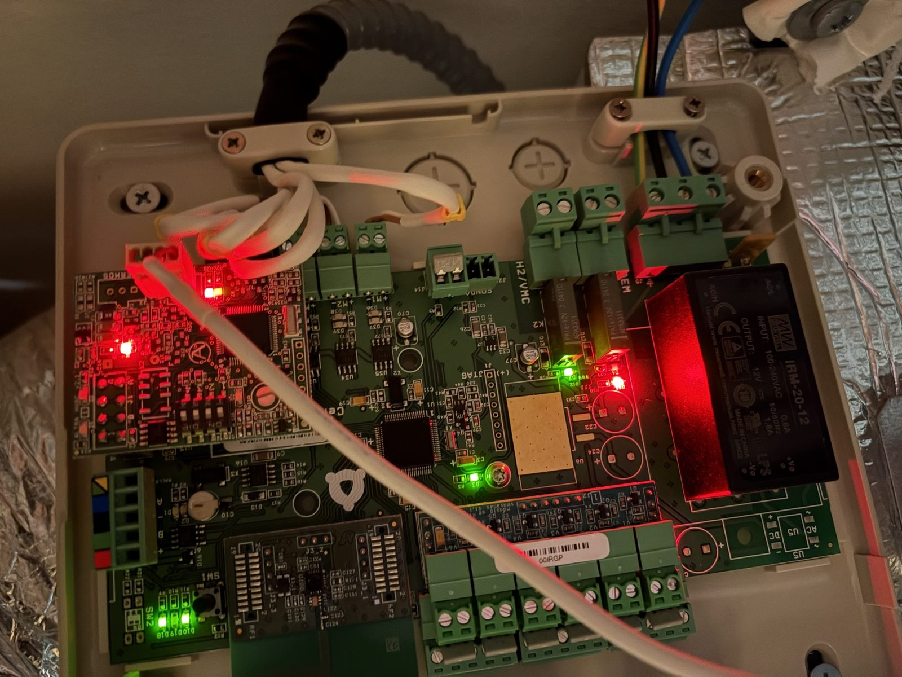 | 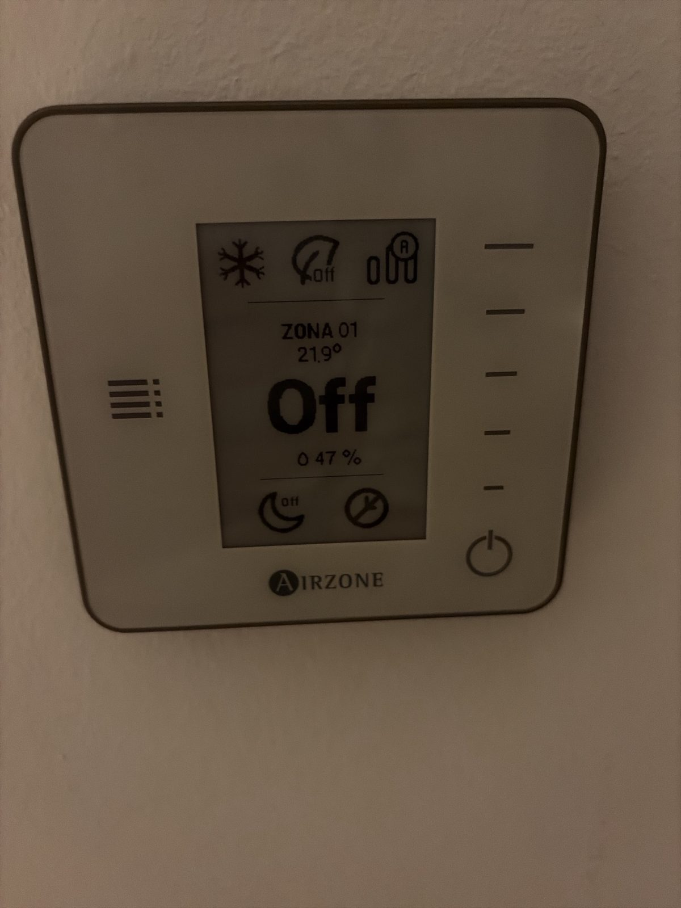 |

> **Safety.** You are working inside an HVAC control box that is also connected to mains voltage. Switch the air conditioning breaker off and check that **all LEDs on the central are off** before touching anything (if some stay on, the central has another supply line: find it or use the main switch). Pull the plug-in terminal block and wire it outside the box. Never touch the 230 V terminals. Everything here is provided as is, **at your own risk**; it may void your warranty.

## Hardware

| Part | Notes |
|---|---|
| ESP32 | Any ESP32 works. We used a **Wemos D1 mini ESP32** (`board: esp32dev`). |
| TTL ↔ RS485 module | One with **automatic direction control** (no DE/RE pin), 3.3 V logic, screw terminals A+/B−/earth. The common blue "TTL to RS485" boards based on MAX485/MAX13487-style transceivers work. **On these boards the TXD/RXD labels name the MCU pin to connect**: module TXD → ESP32 TX, module RXD → ESP32 RX (not crossed). |
| Power | A **12 V → 5 V step-down (buck) with USB output**, fed from the Automation bus itself (the central's 12 V supply is a 20 W Mean Well module; ESP32 + RS485 module draw about 0.03-0.04 A at 12 V). We used a sealed 8-32 V → 5 V 3 A USB-A converter whose input and output negatives are common. Alternatively power the ESP32 from any USB supply, as long as its **ground is shared** with the bus ground. |
| Cable | Short USB cable for the ESP32, two short wires for A and B (twisted together), Dupont wires for the TTL side. |

## Wiring

All connections are on the central's **Automation bus** connector, number ③ on the diagram printed inside the lid (5-pin vertical plug-in terminal block, 12 V; on our PCB the silkscreen says *Domotico*, next to *Maquina*). On our board it was unused.

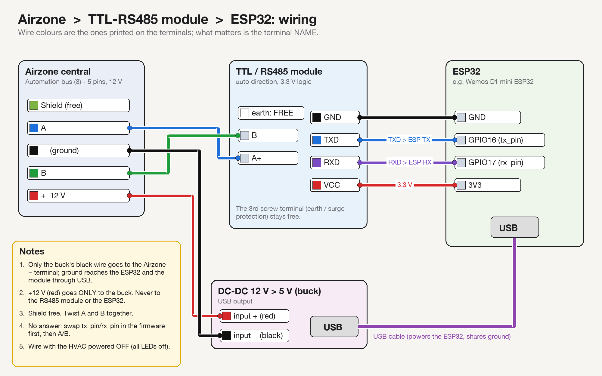

| Automation bus terminal | Colour on the label | Goes to |
|---|---|---|
| Shield (top) | yellow/green | nothing (leave free) |
| **A** | blue | **A+** of the RS485 module |
| **−** | black | **−** input of the 12→5 V buck (only this wire) |
| **B** | green | **B−** of the RS485 module |
| **+** 12 V | red | **+** input of the buck (**never** to the RS485 module or the ESP32) |

| RS485 module (TTL side) | ESP32 |
|---|---|
| VCC | 3V3 |
| GND | GND |
| TXD | GPIO16 (`tx_pin`) |
| RXD | GPIO17 (`rx_pin`) |

- The module's third screw terminal (earth / surge protection) stays free. The common ground reaches the module through the buck → USB → ESP32 GND → module GND (the buck must be non-isolated, i.e. input and output negatives connected).
- The buck's USB output powers the ESP32.
- Twist A and B together. After tightening each screw, pull the wire to check it holds.
- Powering the central off does not lose its configuration (a backup battery on the board keeps it).

| | |
|---|---|
| 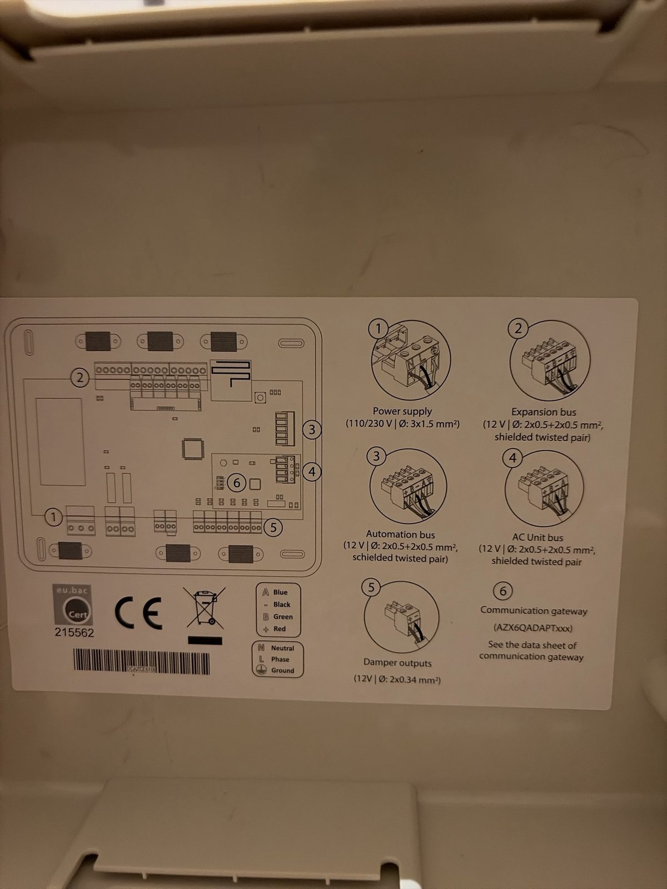 | 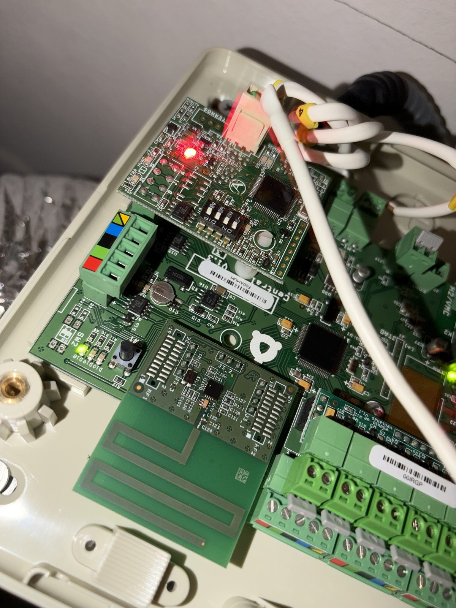 |
| Legend printed inside the lid: ③ is the Automation bus (A blue, − black, B green, + red). The photo of the board is rotated 180° compared to this drawing. | The 5-pin Automation bus connector (colour stickers) next to the machine gateway module. |
| 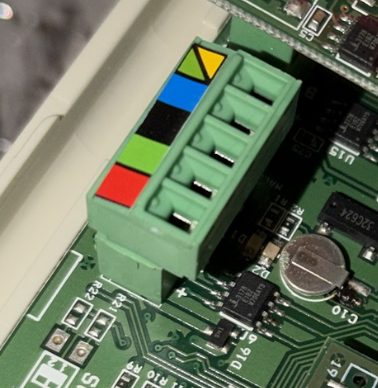 | 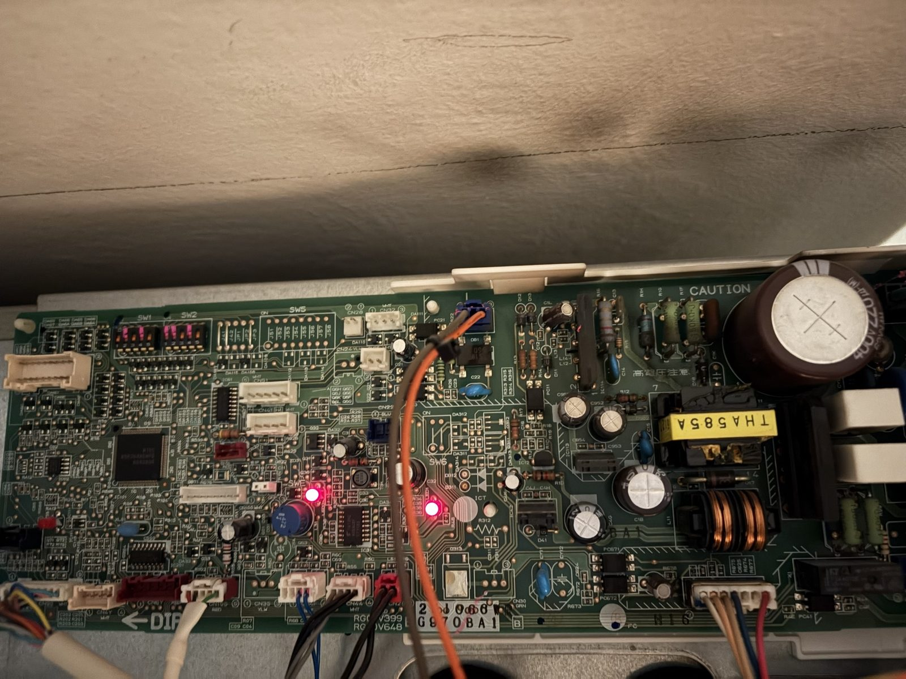 |
| Close-up of the Automation bus connector. | The Mitsubishi Electric indoor unit board (not touched; the Airzone gateway talks to it). |

## Our installation

The real build, step by step (the board on the bench, then mounted in the false ceiling above the central).

| | |
|---|---|
| 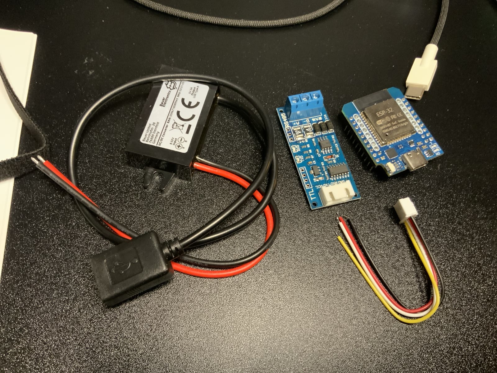 | 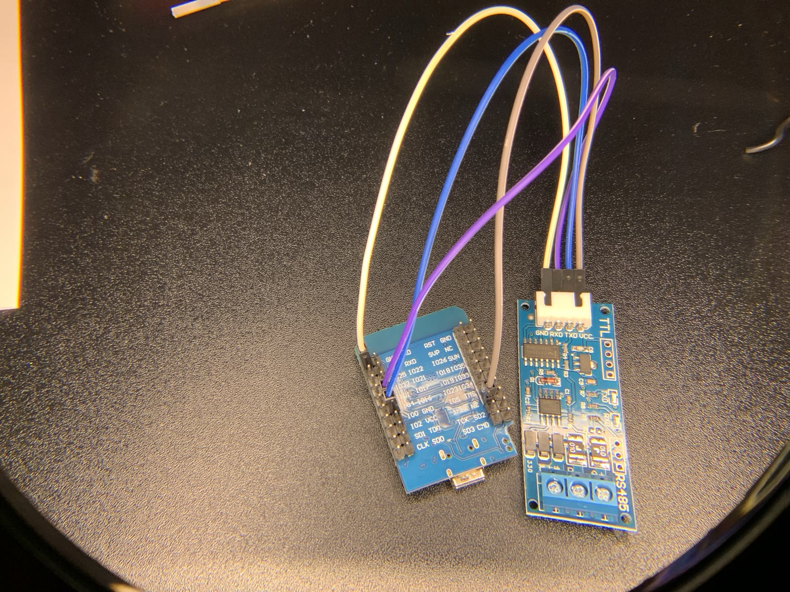 |
| The parts: sealed 12 V → 5 V USB buck, TTL-RS485 module, Wemos D1 mini ESP32, JST cable for the module's TTL header. | Bench test: ESP32 ↔ RS485 module with Dupont wires (VCC/GND/TXD/RXD as in the table above). |
| 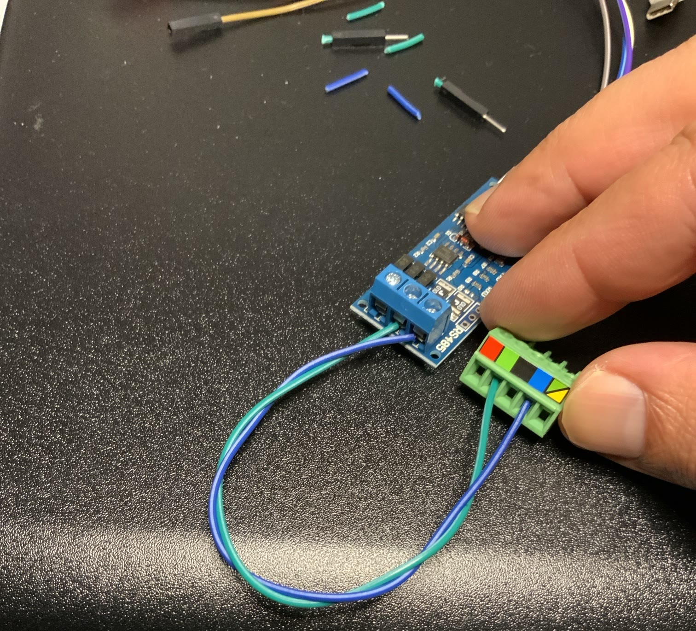 | 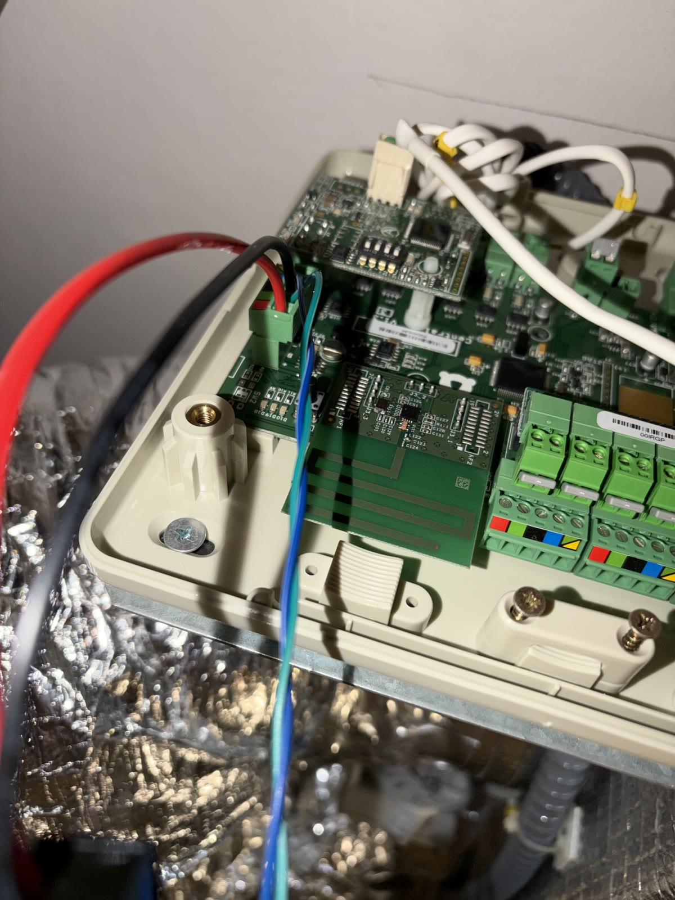 |
| The Automation bus plug wired outside the box: A (blue) and B (green), twisted, to A+ and B− of the module. | The plug back on the central: A/B to the module, + and − (red/black) to the buck. |
| 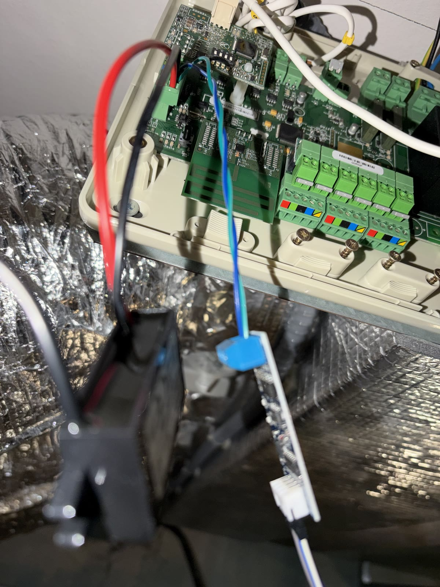 | 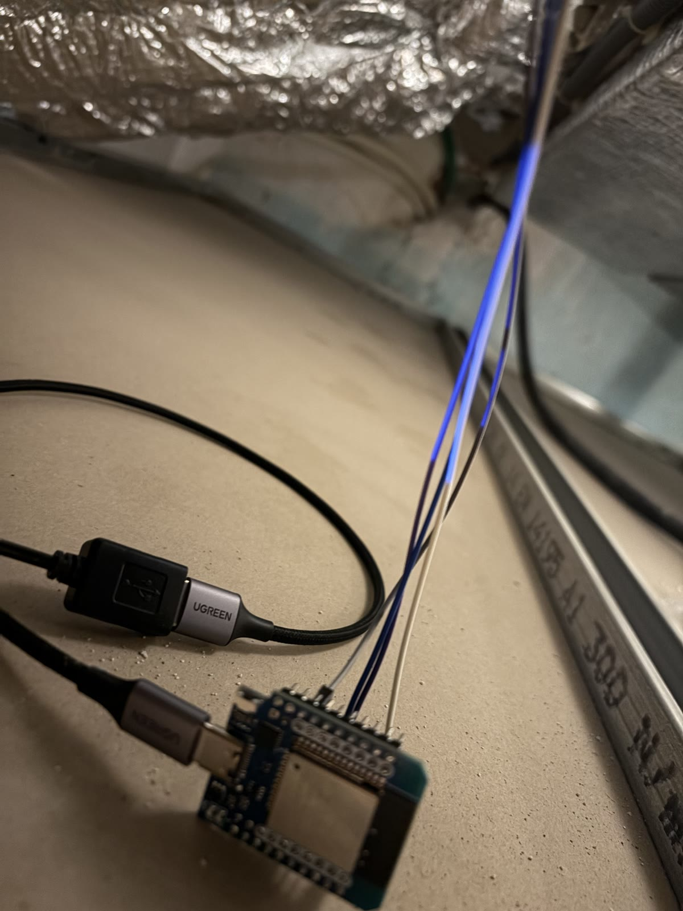 |
| Everything connected at the central: buck (black box) and RS485 module hanging next to it. | The ESP32 resting on the ceiling board, powered by the buck's USB output. |
| 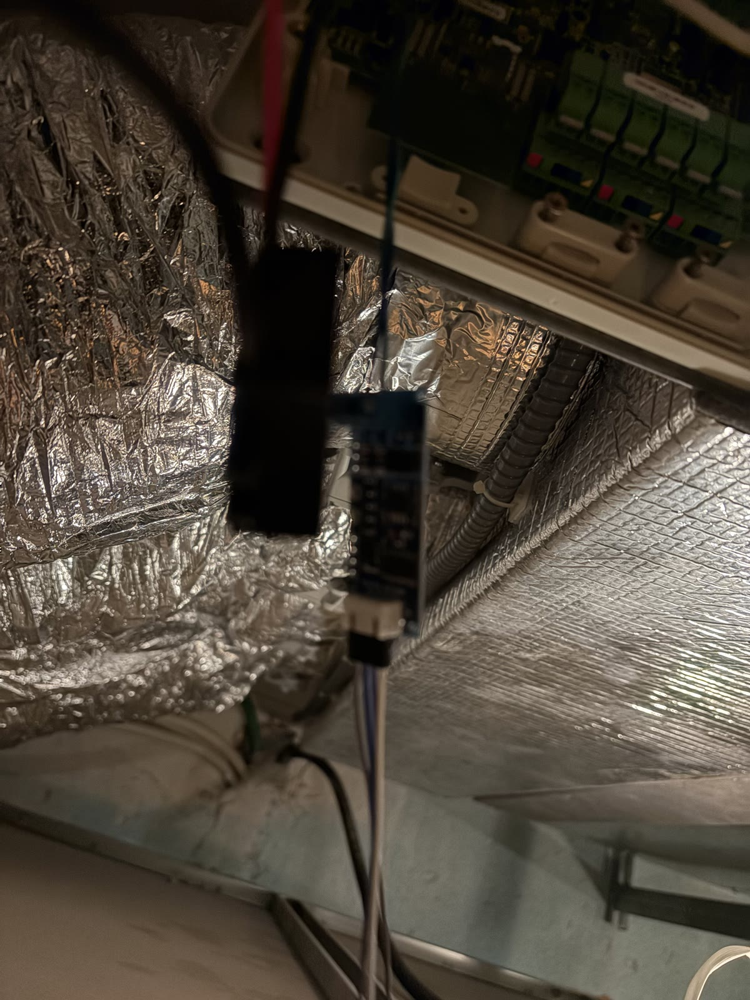 | |
| The RS485 module hangs on its short wires next to the central (a small 3D-printed box is planned). | |

## Modbus settings

| Setting | Value |
|---|---|
| Physical | RS-485, half duplex |
| Serial | **19200 baud, 8 data bits, even parity, 1 stop bit (8E1)** |
| Slave address | **1** |
| Functions | 03/04 read, 06 write single register, 16 write multiple, 22 mask write (see below) |
| Register address | **zone number × 256 + register**; the system registers are zone 0. Zone 127 is broadcast (write only). |

The bus is silent unless someone polls it (the central is a slave), and there is no echo of your own transmission.

## Register map

Only the registers used or verified here. All temperatures are in tenths of a degree (value × 10).

### System registers (zone 0)

| Reg | Content | Used as |
|---|---|---|
| 0 | bits 0-8 **mode**: 0 stop, 1 cool, 3 fan, 4 heat (air), 5 or 258 heat, 6 dry; bits 9-10 **fan speed**: 0 auto, 1 low, 2 medium, 3 high | read + write (mode) |
| 9 | zones present, bitmask (bit 0 = zone 1, …) | diagnostic |
| 10 | inputs and probes: bit 1 = radio module connected | diagnostic |
| 30 | machine gateway errors: bit 3 = communication error | diagnostic |
| 50 | machine brand and errors (bits 8-11 brand; Mitsubishi Electric = 2) | diagnostic, raw |

### Zone registers (base = zone × 256)

| Reg | Content | Used as |
|---|---|---|
| 0 | bit 2 = **zone on**; bits 8-11 = zone mode | read + write (on/off) |
| 3 | **setpoint** × 10 (18-30 °C, 0.5 steps) | read + write |
| 8 | **probe temperature** × 10 (without a remote probe it is the thermostat temperature) | current temperature |
| 9 | zone status: bit 7 = **air demand** (the zone is asking for heating/cooling) | climate action |
| 10 | **thermostat temperature** × 10 (0 for a zone without its own thermostat) | not used, see note |
| 13 | zone errors: bit 8 = **radio thermostat battery low** | binary sensor |

Notes:

- The example uses register 8 for every zone: when a zone has its own thermostat it matches register 10, and it still works for a zone that has only a damper and no thermostat (register 10 = 0).
- **Not supported by this central** (the AZCE6IBPRO6 answers with a Modbus exception): zone humidity (zone register 31) and energy consumption (system register 107), although they appear in the Airzone documentation for other centrals. They are not in the firmware.
- System register 4 (date/time) is writable; this firmware never writes it.
- Radio thermostats may appear in register 9 only a few minutes after the central powers up.
- The Think thermostats are battery-powered e-ink devices: they show changes made over Modbus only after you touch them or after a few minutes.

## The climate component

`esphome/components/airzone_zone` is a small external component that turns one zone into an ESPHome `climate` entity. It does not poll the bus itself: it reads the `modbus_controller` sensors you already declare (temperature, setpoint, zone register 0, system register 0, optional air demand) and writes through the same controller.

- **Setpoint**: function 06 on zone register 3, value × 10, clamped to 18-30 °C and rounded to 0.5.
- **On/off per zone**: bit 2 of zone register 0, done as **read-modify-write with function 06**: the last value read is taken, only bit 2 is changed, the whole register is written back.
- **Mode is global**: the Airzone installation has a single mode for all zones (as on the Think thermostats). Choosing Cool/Heat/Dry/Fan on one zone writes system register 0 (bits 0-8 only, read-modify-write) and therefore changes the mode for **every** zone, then turns that zone on. Choosing Off only turns that zone off. A zone that is on shows the installation's mode; a zone that is off shows Off.
- **Heat** is written as code 4 (air heating); the central may store and report it as 258. Both are shown as Heat.
- **Action** (heating/cooling/drying/fan/idle) comes from bit 7 of zone register 9.
- Writes only happen when you act from Home Assistant, never at boot.

Why not the obvious ESPHome tools:

- **Function 22 (mask write)** would be the clean way to flip a single bit, and the central documents it, but ESPHome's Modbus parser does not recognise the response, so the example uses read-modify-write with function 06 instead.
- The `modbus_controller` **switch with `bitmask`** writes the whole register with the other bits set to zero: on register 0 that would wipe the zone or system mode bits. Do not use it on the registers 0.

The `System mode control` select in `airzone.yaml` changes the installation mode without turning any zone on or off.

## Getting started

1. Install ESPHome (`pip install esphome`, or the ESPHome add-on / dashboard).
2. Copy the `esphome/` folder, then `cp secrets.yaml.example secrets.yaml` and fill in Wi-Fi, fallback hotspot password, API encryption key and OTA password.
3. Adapt `airzone.yaml` (see below), then `esphome run airzone.yaml` (first flash over USB, then OTA).
4. Add the device in Home Assistant (ESPHome integration), using the API key from `secrets.yaml`.

### Adapting it to your installation

- **Zones**: read the `System zones present (bitmask)` sensor first (bit 0 = zone 1). The example has zones 1, 2 and 3 named by the `zone1_name`… substitutions. For each extra zone, copy the commented "zone 4" blocks (binary sensors, sensors, climate) and change the addresses to `zone × 256 + register`. Remove the blocks of zones you don't have.
- **Pins**: `tx_pin` / `rx_pin` are substitutions (GPIO16/GPIO17 on our board). Use any free UART-capable pins of your board and check its pinout.
- **Setpoint range**: `min_temperature` / `max_temperature` on each climate (default 18-30 °C).
- **Secrets**: never commit `secrets.yaml` (it is in `.gitignore`).

## Troubleshooting

With `logger: level: DEBUG` the ESPHome log shows every Modbus frame sent and received.

- **No answer at all**: first swap `tx_pin` and `rx_pin` in the firmware. On many TTL-RS485 modules the TXD/RXD labels mean "connect to the MCU's TX/RX", not the module's own pins. A typical symptom of the wrong way round: the module's RX LED blinks but nothing goes out on the bus.
- Then **swap A and B** on the module.
- Check **parity: 8E1** (even), not 8N1, and 19200 baud.
- Check the **common ground** between the ESP32/module and the bus − terminal (through a non-isolated buck or a ground wire).
- Still nothing: flash **`airzone-scan.yaml`** (read-only). It cycles through 19200/9600/38400 baud, even/no parity and addresses 1-10, sends a read of register 0 to each, and logs anything that comes back; a `Modbus scan` text sensor summarises the hits. It uses the same node name as `airzone.yaml`, so you can switch between the two over OTA.
- Writes rejected or ignored: look at the log for a Modbus exception; registers that this central does not implement (31, 107) answer with an exception.

## Repository layout

```
esphome/
  airzone.yaml              main firmware (example, 3 zones)
  airzone-scan.yaml         Modbus scan firmware (troubleshooting)
  az_scan.h                 scan logic used by airzone-scan.yaml
  secrets.yaml.example      copy to secrets.yaml
  components/airzone_zone/  climate external component
docs/
  wiring-diagram.png
  photos/
```

## Credits and references

- The same central and bus were first documented with an Elfin EW11A gateway by a member of the HACF (Home Assistant Communauté Francophone) forum: [Intégrer un Airzone Innobus Pro6 (CE6) dans Home Assistant via un Elfin EW11A](https://forum.hacf.fr/t/integrer-un-airzone-innobus-pro6-ce6-dans-home-assistant-via-un-elfin-ew11a/82470), with the guide in [akunia/airzone-ce6-ew11a-home-assistant](https://github.com/akunia/airzone-ce6-ew11a-home-assistant). That work confirmed the connector, the bus settings and the slave address.
- Official Airzone documentation: *AZ6 Modbus* manual (MI_AZ6_MODBUS_A4_MUL, which lists the AZCE6IBPRO6, and the newer MI_AZX6_MODBUS_MUL) and the online register table [OBJ_AZ6_MODBUS_RTU_TCPIP](https://support.airzonecontrol.com/aa/en/qrc/OBJ_AZ6_MODBUS_RTU_TCPIP).
- [gpulido/python-airzone](https://github.com/gpulido/python-airzone) (Innobus register handling) and [gpulido/homeassistant-airzone](https://github.com/gpulido/homeassistant-airzone).
- [exelsis423/airzone-modbus](https://github.com/exelsis423/airzone-modbus), registers verified on an AZCE6FLEXA3.

Airzone, Think, Innobus and Mitsubishi Electric are trademarks of their respective owners. This project is not affiliated with or endorsed by them.

## License

MIT, see [LICENSE](LICENSE).
